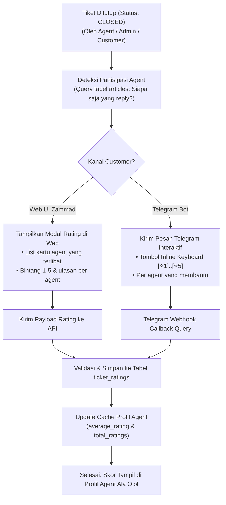

# 📋 PLAN PENGEMBANGAN FITUR RATING AGENT & ADMIN (SISTEM TIKET ZAMMAD)

> **Status Analisis:** 100% SANGAT MEMUNGKINKAN (FEASIBLE)  
> **Tanggal Pembuatan:** 19 Oktober 2026  
> **Target Platform:** Web UI Zammad (Desktop & Mobile) & Integrasi Telegram Bot  
> **Lokasi Implementasi:** `/home/faylastraub/Zammad/Zammad-Custom/` (Layer Overlay)

---

## 1. Ringkasan Eksekutif & Tujuan

Fitur ini bertujuan untuk mengukur kepuasan pelanggan (*customer satisfaction / CSAT*) terhadap penanganan kendala oleh tim support. Mengingat dalam 1 tiket pelanggan dapat dibantu oleh lebih dari satu Agent/Admin, sistem dirancang untuk memberikan **penilaian spesifik per individu agent** yang berpartisipasi, dan menampilkan skor agregat di profil masing-masing agent layaknya sistem rating driver pada aplikasi *ride-hailing* (ojek online).

### Poin Kunci Kebutuhan:
1. **Trigger Penutupan Tiket**: Form rating hanya aktif dan muncul saat status tiket berubah menjadi `closed` (baik ditutup oleh Agent, Admin, maupun Customer itu sendiri).
2. **Multi-Agent Evaluation**: Jika dalam satu tiket ada 3 agent yang membalas, customer dapat memberikan rating (1–5 bintang) ke masing-masing dari ketiga agent tersebut.
3. **Tampilan Profil Ala Ojol**: Profil Agent/Admin menampilkan rata-rata bintang (misal: `★ 4.9`), total ulasan yang diselesaikan, dan rincian rating.
4. **Dukungan Dua Kanal (Omnichannel)**:
   - **Web UI**: Popup modal / kartu ulasan saat tiket ditutup.
   - **Telegram Bot**: Pesan otomatis penutupan tiket disertai *Telegram Inline Keyboard* tombol bintang interaktif.

---

## 2. Alur Kerja Sistem (System Workflow)



---

## 3. Rencana Arsitektur Database & Model

Semua tabel dan penyesuaian model ditempatkan pada layer kustomisasi tanpa merusak integritas database default Zammad.

### A. Tabel Baru: `ticket_ratings`
Menyimpan riwayat penilaian setiap tiket terhadap masing-masing agent:

| Nama Kolom | Tipe Data | Keterangan |
| :--- | :--- | :--- |
| `id` | `BIGINT` | Primary Key |
| `ticket_id` | `BIGINT` | Foreign Key ke tabel `tickets` |
| `customer_id`| `BIGINT` | Foreign Key ke tabel `users` (Pemilik tiket) |
| `agent_id` | `BIGINT` | Foreign Key ke tabel `users` (Agent yang dinilai) |
| `rating` | `INTEGER` | Nilai bintang (1 s/d 5) |
| `comment` | `TEXT` | Ulasan/pesan opsional dari customer |
| `created_at` | `TIMESTAMP`| Waktu rating dibuat |
| `updated_at` | `TIMESTAMP`| Waktu update |

*Constraint & Index:*
- `UNIQUE INDEX (ticket_id, agent_id)`: Mencegah customer memberikan rating ganda ke agent yang sama pada satu tiket.
- `INDEX (agent_id)`: Mengoptimalkan performa kalkulasi profil agent.

### B. Penambahan Kolom Cache pada Tabel `users`
Untuk efisiensi pembacaan data profil tanpa perlu query agregasi berulang:
- `average_rating` (`DECIMAL(3,2)`, Default: `0.00`): Rata-rata bintang agent.
- `total_ratings` (`INTEGER`, Default: `0`): Jumlah total ulasan yang diterima.

---

## 4. Mekanisme & Logika Backend

### A. Deteksi Agent yang Berpartisipasi
Ketika tiket ditutup, sistem memeriksa riwayat pesan (`articles`) pada tiket:
```ruby
# Mengambil ID semua user selain customer yang membuat artikel di tiket ini
participating_agent_ids = ticket.articles
                                .where.not(created_by_id: ticket.customer_id)
                                .distinct
                                .pluck(:created_by_id)

participating_agents = User.where(id: participating_agent_ids)
```

### B. Hook / Observer Penutupan Tiket
Memanfaatkan event lifecycle `Ticket` pada Rails:
- Memeriksa apakah `state_id` berubah ke `closed`.
- Jika iya, pemicu notifikasi dan form review langsung diaktifkan.

### C. Background Calculation Job
Setiap kali ada rating baru yang masuk, sebuah background job (`RatingCacheJob`) dijalankan untuk memperbarui nilai rata-rata bintang agent secara instan di tabel `users`.

---

## 5. Implementasi Antarmuka (Web UI)

### A. Modal / Form Rating (Kanal Web)
- Muncul secara otomatis saat customer mengakses atau menutup tiket yang statusnya `closed` dan belum dinilai.
- Setiap agent ditampilkan dalam kartu terpisah yang memuat:
  - Foto profil (avatar) dan nama lengkap agent.
  - Komponen pemilihan bintang interaktif (1 s/d 5 bintang warna emas).
  - Kolom teks ulasan singkat (opsional).
  - Tombol submit ulasan.

### B. Tampilan Profil Agent (Ala Ojek Online)
Pada kartu atau halaman profil agent/admin:
- **Badge Skor Utama**: Angka besar tebal (contoh: **4.88**).
- **Visualisasi Bintang**: Deretan 5 bintang dengan efek highlight emas.
- **Statistik Pelayanan**: Contoh `(142 Ulasan Diselesaikan)`.
- **Rincian Bintang**: Progress bar distribusi (Bintang 5 s/d Bintang 1).

---

## 6. Implementasi Integrasi Telegram

Zammad telah memiliki channel Telegram yang aktif. Mekanisme rating melalui bot Telegram akan bekerja sebagai berikut:

### A. Format Pesan Rating Bot
Saat tiket ditutup, bot mengirimkan pesan otomatis ke chat Telegram pelanggan:
```text
✅ Tiket #10294 telah selesai ditutup.
Terima kasih telah menghubungi layanan IT Helpdesk.

Mohon berikan penilaian atas pelayanan agent yang membantu Anda:

👤 Agent: Ahmad Fauzi
Pilih bintang pelayanan:
[ ⭐ 1 ] [ ⭐ 2 ] [ ⭐ 3 ] [ ⭐ 4 ] [ ⭐ 5 ]
```

### B. Penanganan Multi-Agent di Telegram
Jika tiket ditangani oleh lebih dari 1 agent:
1. Bot mengirim ulasan untuk **Agent 1**.
2. Setelah customer mengklik tombol bintang, bot mencatat respon via *Callback Query* dan langsung menyajikan tombol ulasan untuk **Agent 2**, begitu seterusnya hingga seluruh agent selesai dinilai.
3. Bot mengirimkan pesan konfirmasi penutup: *"Terima kasih atas penilaian Anda! Semoga kendala Anda terselesaikan dengan baik."*

---

## 7. Keamanan & Validasi Sistem

1. **Otorisasi Ketat**: Hanya customer pemilik tiket yang sah yang diizinkan mengirimkan ulasan pada tiket tersebut.
2. **Validasi Status**: Rating hanya diterima jika status tiket benar-benar `closed`.
3. **Pencegahan Duplikasi**: Sistem menolak upaya pengiriman ulasan berulang untuk pasangan tiket-agent yang sama.
4. **Kepatuhan Aturan Project (`AGENTS.md`)**: Implementasi ini murni pada modul tiket & profil tanpa mengubah mekanisme verifikasi email atau konfigurasi SMTP Zammad.

---

## 8. Rencana Tahapan Eksekusi (Roadmap)

| Tahap | Lingkup Pekerjaan | Output |
| :---: | :--- | :--- |
| **Tahap 1** | **Database & Model Foundation**<br/>• Migrasi tabel `ticket_ratings`<br/>• Penambahan kolom cache di `users`<br/>• Model ActiveRecord & validasi | Struktur database siap & teruji di PostgreSQL |
| **Tahap 2** | **Backend API & Observer Engine**<br/>• Hook deteksi tiket ditutup<br/>• Endpoint API penerimaan rating<br/>• Service kalkulasi rata-rata skor | API backend siap menerima rating web & webhook |
| **Tahap 3** | **Web UI Rating & Desain Profil Ojol**<br/>• Modal dialog rating untuk customer<br/>• Desain kartu profil rating agent (bintang emas & statistik) | Tampilan ulasan web interaktif |
| **Tahap 4** | **Integrasi Telegram Channel**<br/>• Handler pesan bot penutupan tiket<br/>• Telegram Inline Keyboard buttons<br/>• Callback query processor | Fitur rating via Telegram berfungsi mulus |
| **Tahap 5** | **Testing, Audit & Dokumentasi**<br/>• Uji coba multi-agent rating<br/>• Uji coba penutupan via customer vs via agent<br/>• Verifikasi kalkulasi skor di profil | Siap diserahterimakan ke client |

---

## 9. Kesimpulan

Rencana ini siap dieksekusi dengan pendekatan arsitektur modular di folder `Zammad-Custom/`, sehingga instalasi utama Zammad tetap aman, stabil, dan dapat di-*upgrade* di kemudian hari tanpa risiko kehilangan data rating.

